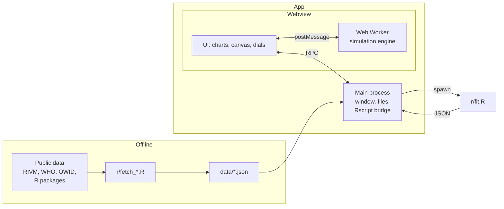

# Epidemica

A desktop app for looking at past epidemics and simulating new ones.

Epidemica has two modes:

- **History.** Charts of real outbreaks: daily cases, deaths and the reproduction number R(t) over time. Pick two outbreaks and compare them on the same axes.
- **Simulate.** An agent-based dashboard. Describe a virus (how easily it spreads, how long people are ill, how many show symptoms, how deadly it is), pick a setting (a city, a school, a care home) and watch it move through a population. Change the dials while it runs.

The two modes are linked. R fits parameters to a past outbreak, and those parameters can be loaded straight into the simulator: "what if measles in 1861 had hit a modern city?"

A simulation is not a prediction. Every line in the app is labelled **Reported** (real data), **Fitted** (estimated by R from real data) or **Simulated** (made up by the model), and each label has its own fixed colour.

Semester 3 (Data Dynamics) individual project, T!CS, NHL Stenden, 2026-2027.

## Problem and objectives

Numbers like "R0 = 2.5" or "5 day incubation" are reported for every new outbreak, but it is hard to picture what they mean. Why did measles spread so much faster than Ebola? Why can a virus with mild symptoms be harder to stop than a deadly one? How much does a lockdown on day 20 change compared with one on day 40?

Epidemica tries to answer those questions by putting real outbreak data next to a simulation you can play with.

Objectives:

1. Clean and chart at least four historic outbreaks from public data, with R as the analysis language.
2. Estimate R0 and R(t) for each outbreak in R, with uncertainty intervals.
3. Build an agent-based simulator whose fully mixed runs match the textbook SIR final size within 5% (see [Checking the model](#checking-the-model)).
4. Let a user load fitted parameters from a past outbreak into the simulator and compare the simulated curve with the reported one.

## Simulation model

Each person is an agent that walks around a square world. An agent is in one of these states:

```
Susceptible -> Exposed -> Infectious -> Recovered
                              |             |
                              v             v (waning immunity)
                             Dead       Susceptible
```

- One tick is one simulated hour. Charts show daily totals (24 ticks).
- An infectious agent can infect any susceptible agent inside its contact radius. The chance per contact per tick is **p = R0 / (c x D)**, where c is the expected number of contacts per tick and D is the infectious period in ticks. With this choice, one infectious agent in a fully susceptible population causes R0 infections on average.
- Time spent in Exposed and Infectious is drawn around the dial value, so not everyone recovers on the same day.

### Dials

| Group | Dial | What it does |
|---|---|---|
| Spread | R0 | Average number of people one case infects in a fully susceptible population |
| | Incubation period (days) | Time in Exposed before becoming infectious |
| | Infectious period (days) | Time spent infectious |
| Symptoms | Share asymptomatic | Infected agents who never show symptoms |
| | Asymptomatic infectiousness | How infectious a case without symptoms is, relative to one with symptoms |
| | Self-isolation | How much symptomatic agents cut their movement |
| Outcome | Fatality | Share of cases that die |
| | Waning immunity (days) | How long recovery protects; off means lifelong |
| Interventions | Masks | Cut in the chance of passing it on per contact |
| | Vaccination coverage | Share of agents who start immune |
| | Lockdown day | Day movement drops; off means never |
| | Testing and isolation | Share of symptomatic cases found and removed from contact |

### Settings

A setting is a preset for population size, density, movement and age mix:

| Setting | Idea |
|---|---|
| City | Many people, dense, lots of movement |
| Village | Few people, spread out |
| School | Dense in the day, mostly young, low fatality |
| Care home | Small, dense, old, high fatality |
| Festival / cruise ship | Very dense, closed population |

### Load from history

Pick a past outbreak and R estimates its R0, incubation and infectious period. The app fills the dials with those values, and the reported curve is drawn behind the simulated one.

### Checking the model

The simulator has to agree with theory before its curves mean anything. In a fully mixed population, the share of people an SIR epidemic ends up infecting, z, solves

```
z = 1 - exp(-R0 * z)
```

The engine test runs 20 seeded, fully mixed outbreaks of 5,000 agents at several R0 values and checks that the mean attack rate is within 5% of z. R's `deSolve` SIR model is used as a second reference.

## Where R fits

R does the data science. It runs in two ways:

- **Offline pipeline.** `r/fetch_*.R` scripts download the raw data, clean it into one shape (date, new cases, deaths, plus R(t) and its interval) and write `data/<outbreak>.json`. The app only ever reads these files, so it works without the internet.
- **Live from the app.** When you press "Fit" or "Load from history", the app runs `Rscript r/fit.R --outbreak <id>` and reads JSON back from it. This is how R0, R(t) and the fitted curve get into the simulator.

R packages:

| Package | Used for |
|---|---|
| jsonlite | Writing JSON for the app |
| EpiEstim | R(t) from daily incidence and a serial interval; also ships the 1918 flu and 1861 measles datasets |
| outbreaks | Historic outbreak datasets |
| deSolve | SIR reference model |
| mgcv | Smoothing noisy case series (GAM) |

## Datasets

| Outbreak | Source | What |
|---|---|---|
| COVID-19, Netherlands | RIVM open data ([data.rivm.nl](https://data.rivm.nl), [wastewater](https://data.overheid.nl/en/dataset/38662-covid-19-nationale-sars-cov-2-afvalwatersurveillance-landelijke-dagcijfers)), Our World in Data for vaccinations | Daily cases, deaths, vaccinations, wastewater load |
| Influenza, 1918 | `EpiEstim::Flu1918` | Daily incidence in Baltimore, with a serial interval |
| Ebola, West Africa 2014-16 | `outbreaks::ebola_sierraleone_2014`, WHO situation reports | Case line list (Sierra Leone) and country totals |
| Measles | `outbreaks::measles_hagelloch_1861`, WHO / Our World in Data | 1861 Hagelloch village outbreak (line list), yearly cases worldwide |
| Mpox | Our World in Data | Daily cases since 2022 |

Source URLs, access dates and licences are kept in the header of each `r/fetch_*.R` script and repeated in the report.

## Architecture



- The engine runs in a Web Worker inside the webview, so the agent positions it produces every tick never have to cross the RPC bridge.
- The main process opens the window, reads the files in `data/` and runs R. It never simulates.
- There is no database. Data lives in JSON files; a running simulation lives in memory.

## Stack

| Layer | Choice |
|---|---|
| Desktop shell | [Electrobun](https://framework.blackboard.sh/electrobun/) 2 (system webview, WebKitGTK on Linux) |
| Build tool | Hutch (Electrobun's CLI: dependencies, bundling, dev server) |
| Main process | Bun runtime |
| Language | TypeScript everywhere in the app |
| Simulation drawing | Canvas 2D |
| Charts | uPlot (to confirm when the first chart is built) |
| Data analysis | R 4.5 |
| Look | Plain monospace, light and dark from the system setting |

## Layout

```
epidemica/
├── README.md
├── package.json
├── hutch.config.ts         tasks: install, dev, build, test
├── electrobun.config.ts    app name, main process, views
├── tsconfig.json
├── src/
│   ├── bun/index.ts        main process: window, RPC handlers, Rscript bridge
│   ├── shared/rpc.ts       RPC types shared by main process and webview
│   ├── mainview/           the UI: index.html, index.ts, style.css
│   └── engine/             the simulation: types, engine, worker
├── r/
│   ├── install.R           installs the R packages
│   ├── fetch_*.R           one script per outbreak, writes data/<outbreak>.json
│   └── fit.R               called by the app: fits an outbreak, prints JSON
└── data/                   cleaned datasets (JSON); data/raw/ is not committed
```

## Getting started

Needs Linux, macOS or Windows, R 4.5 and Node.js (for `npx`) or Hutch.

```bash
npx electrobun --version      # first run bootstraps Hutch
hutch run install             # JavaScript dependencies
Rscript r/install.R           # R packages
hutch run dev                 # opens the app, rebuilds on save
```

Rebuild the datasets:

```bash
Rscript r/fetch_flu1918.R     # or any other fetch_*.R
```

## Roadmap

**Mid-term (upload Sunday 1 November 2026)**

- [x] README and project outline
- [ ] App skeleton: window, History and Simulate tabs, R bridge
- [ ] R pipeline for the four outbreaks, with exploratory analysis
- [ ] First History chart from `data/*.json`
- [ ] Engine passes the SIR final-size test

**Final**

- [ ] Simulate dashboard: canvas, live chart, all dials
- [ ] Settings presets
- [ ] R fits (R0, R(t)) for each outbreak, "Load from history" into the simulator
- [ ] Compare two outbreaks in History
- [ ] Report, demo video, presentation

**If there is time**

- Age groups with their own fatality
- Several towns with travel between them
- Shareable scenario files

## Limitations

- The simulator is a teaching model. Agents walk at random; real people have homes, jobs and friends.
- Historic data is patchy. Old outbreaks were counted by hand, recent ones depend on how much testing was done, and reporting rules changed during COVID-19.
- R0 fitted from early growth depends on the serial interval assumed, which is itself an estimate.

## AI use

Parts of this project are built with an AI assistant (Claude Code). What it was used for, and what was checked or rewritten by hand, is recorded in the personal portfolio, as the semester guide asks.
