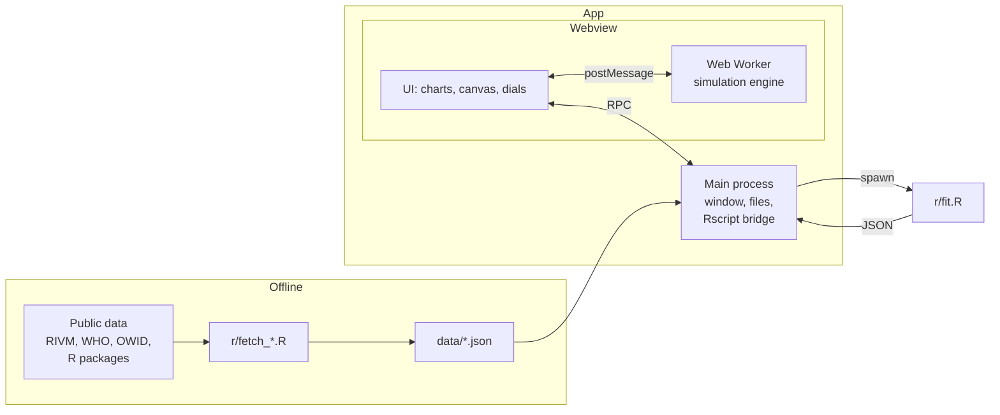

# Epidemica

A desktop app for looking at past epidemics and simulating new ones.

Epidemica has two modes:

- **History.** Charts of real outbreaks: daily cases, deaths and the reproduction number R(t) over time. Pick two outbreaks and compare them on the same axes.
- **Simulate.** An agent-based dashboard. Describe a virus (how easily it spreads, how long people are ill, how many show symptoms, how deadly it is), pick a setting (a city, a school, a care home) and watch it move through a population. Change the dials while it runs.

The two modes are linked. R fits parameters to a past outbreak, and those parameters can be loaded straight into the simulator: "what if measles in 1861 had hit a modern city?"

A simulation is not a prediction. Every line in the app is labelled **Reported** (real data), **Fitted** (estimated by R from real data) or **Simulated** (made up by the model), and each kind is drawn its own way: fitted lines are purple (dashed where they sit on top of data), a reported curve behind a simulation is a grey area, and simulated lines take the colour of their agent state.

Semester 3 (Data Dynamics) individual project, T!CS, NHL Stenden, 2026-2027.

## Problem and objectives

Numbers like "R0 = 2.5" or "5 day incubation" are reported for every new outbreak, but it is hard to picture what they mean. Why did measles spread so much faster than Ebola? Why can a virus with mild symptoms be harder to stop than a deadly one? How much does a lockdown on day 20 change compared with one on day 40?

Epidemica tries to answer those questions by putting real outbreak data next to a simulation you can play with.

Objectives:

1. Clean and chart at least four historic outbreaks from public data, with R as the analysis language.
2. Estimate R0 and R(t) for each outbreak in R, with uncertainty intervals.
3. Build an agent-based simulator whose fully mixed runs match the textbook SIR final size within 5% (see [Checking the model](#checking-the-model)).
4. Let a user load fitted parameters from a past outbreak into the simulator and compare the simulated curve with the reported one.

## Simulation model

Each person is an agent that walks around a square world. An agent is in one of these states:

```
Susceptible -> Exposed -> Infectious -> Recovered
                              |             |
                              v             v (waning immunity)
                             Dead       Susceptible
```

- One tick is one simulated hour. Charts show daily totals (24 ticks).
- An infectious agent can infect any susceptible agent inside its contact radius. The chance per contact per tick is **p = R0 / (c x D)**, where c is the expected number of contacts per tick and D is the infectious period in ticks. With this choice, one infectious agent with symptoms in a fully susceptible population causes R0 infections on average. An agent without symptoms passes it on at the asymptomatic infectiousness dial times that, so with the default dials (30% without symptoms, half as infectious) the average case causes 0.85 x R0.
- Time spent in Exposed and Infectious is drawn around the dial value (uniformly between half and one and a half times it), so not everyone recovers on the same day.
- Because p is divided by c, R0 means the same in every setting. Density and movement change how fast the virus gets around, not R0.
- The world wraps at the edges, so there are no corners to hide in. A grid of cells one contact radius wide means an agent only checks its own cell and the 8 around it for contacts.
- Agents walk in a straight line and now and then turn. Symptomatic agents walk slower by the self-isolation dial.
- Lockdown: from the lockdown day agents walk at a quarter of their speed, and the contacts that still happen pass the virus on at 30% of the usual chance.
- Testing: a symptomatic case is tested with the chance on the testing dial, and isolated (no movement, no contacts) one day after its symptoms start. Cases without symptoms are never tested.
- Vaccinated agents start as Recovered, so with waning immunity they become susceptible again too.
- A run is seeded: the same seed and dials give exactly the same run.

### Dials

| Group | Dial | What it does |
|---|---|---|
| Spread | R0 | Average number of people one case with symptoms infects in a fully susceptible population (a case without symptoms: times asymptomatic infectiousness) |
| | Incubation period (days) | Time in Exposed before becoming infectious |
| | Infectious period (days) | Time spent infectious |
| Symptoms | Share asymptomatic | Infected agents who never show symptoms |
| | Asymptomatic infectiousness | How infectious a case without symptoms is, relative to one with symptoms |
| | Self-isolation | How much symptomatic agents cut their movement |
| Outcome | Fatality | Share of cases that die |
| | Waning immunity (days) | How long recovery protects; off means lifelong |
| Interventions | Masks | Cut in the chance of passing it on per contact |
| | Vaccination coverage | Share of agents who start immune |
| | Lockdown day | Day movement drops; off means never |
| | Testing and isolation | Share of symptomatic cases found and removed from contact |

### Settings

A setting is a preset for population size, density, movement and age mix:

| Setting | Idea |
|---|---|
| City | Many people, dense, lots of movement |
| Village | Few people, spread out |
| School | Dense in the day, mostly young, low fatality |
| Care home | Small, dense, old, high fatality |
| Festival / cruise ship | Very dense, closed population |

### Dashboard

The Simulate tab has the setting picker, a seed, start/pause, step (one hour at a time), reset and a speed slider (half a day to 30 days per second). Speed only changes how many ticks run per second, never what happens in a tick, so a run with the same seed and dials ends the same at any speed.

- **Canvas.** One dot per agent, coloured by state: susceptible grey, exposed amber, infectious red, recovered blue, dead black (white in the dark theme). Everyone but the susceptible is drawn a bit larger so the few cases in a crowd stand out.
- **Dials.** Every dial in the table above, grouped the same way. They act on the running engine from the next tick, except vaccination coverage, which only counts when a run starts and says "applies on reset". Waning immunity and lockdown have an "off" box. Picking a setting loads its dials and starts a fresh run.
- **Chart.** Two panels with a shared day axis: agents in each state, and new infections and deaths per day. Every line is labelled "(simulated)". The second panel has the shape of a reported outbreak, and "Load from history" draws the real curve behind it.

### Fit and Load from history

Pick a past outbreak and R estimates its R0 and R(t); the incubation and infectious periods come from the literature. The app fills the dials with those values, and the reported curve is drawn behind the simulated one.

- **Fit (History tab).** "fit" runs `r/fit.R` for the outbreak on screen, which takes about 5 seconds ("fit both" in compare mode runs them one after the other). The summary gives R0 with its 95% confidence interval, the growth window it was estimated from and the doubling time there. The cases panel shades that window and draws the fitted early growth over it, dashed. An R(t) panel follows, with its 95% credible band and a line at R = 1; its axis follows the estimates, so very wide early bands are cut off at the top (the legend gives their numbers). Fits are kept for the session only, never on disk, so a changed `fit.R` or dataset is never shown with an old estimate. Yearly data cannot be fitted.
- **Load into simulator.** From History's "load into simulator" button or the Simulate tab's "from history" picker. Four dials change:

  | Dial | Set to |
  |---|---|
  | R0 | the fitted R0, to 0.01 |
  | Incubation period | epiparameter's published value, to 0.1 day; unchanged if there is none |
  | Infectious period | the value in `r/parameters.R`, to 0.1 day; unchanged if there is none |
  | Asymptomatic infectiousness | 100% |

  The fitted R0 is the average over every infection, and case counts cannot tell cases with and without symptoms apart. The model's R0 is that of a case with symptoms, so 100% is the only value at which the model's average R0 is the fitted one (left at 50%, 1918 flu would run at 1.15 instead of 1.35). Everything else stays as you set it: the setting, the seed, share asymptomatic, self-isolation, fatality and the interventions. Fatality is not loaded, because the dial is the share of all infections that die, while reported deaths per reported case leave out the mild cases nobody counted; the note shows that ratio for information (measles 6.4%, Ebola West Africa 42.3%, COVID-19 0.27%). Picking another setting keeps the loaded dials ("measles in a village"), and "nothing" puts the four back to the setting's values. Loading resets the run without starting it, so day 0 lines up.
- **The reported curve behind the run.** The per-day panel draws the outbreak's reported cases as a grey area behind the simulated infections. Day 0 is the first day of the growth window, which is shaded, with the fitted growth dashed over it and a line on the day 10% of the agents have been infected. The panel switches to a log scale (linear below 0.1 a day, so days of 0 still show), and only slopes can be compared there: the real outbreak's population is not in the data, and on a log axis every constant factor (population size, under-reporting, cases without symptoms, 5 first cases against one) is just a vertical shift. A matching slope inside the window says the model, with these dials, grows at the reported early rate. After the window, and after the 10% line, the curves are expected to part. Heights, peak timing, final size and deaths cannot be read from it.
- **The growth check.** A line under the notes compares the reported doubling time with the model's, worked out from the dials as they are. The model's mean generation time is the incubation period plus 13/24 of the infectious period: stays are drawn between half and one and a half times the dial, and a longer infectious stay passes the virus on to more people. Euler-Lotka turns R and that distribution into a growth rate, fully mixed and early on (`src/engine/growth.ts`; `growth.test.ts` checks it against the engine itself, 0.0787 a day against 0.0801). With the loaded dials:

  | Outbreak | Reported doubling (days) | Model, fully mixed (days) |
  |---|---|---|
  | Influenza, Baltimore 1918 | 5.5 | 8.3 |
  | Measles, Hagelloch 1861 | 6.1 | 9.8 |
  | Ebola, Sierra Leone | 30.0 | 29.7 |
  | Ebola, West Africa | 65.4 (the interval includes no growth) | 61.9 |
  | Mpox | 15.5 | 46.8 |
  | COVID-19, Netherlands | 2.9 | 6.7 |

  Ebola matches. COVID-19 grows two times slower in the model: people passed it on before symptoms (its serial interval, 4.7 days, is shorter than the incubation period, 5.6), and in the model nobody is infectious before the incubation period ends. Mpox grows three times slower for another reason: its 21-day infectious period alone adds 11.4 days to a model generation, twice the 5.6-day serial interval, because a case in the model passes it on at the same rate to the end while real cases mostly passed it on early. Flu and measles are slower too, because the serial interval R0 was fitted with is shorter than the model's generation time (for measles also because of spread before the rash). The growth check names whichever of these applies. That mismatch is a finding about the model, not a bug, and there is deliberately no button to force the curves together. Agents walking in a world, rather than fully mixed, are slower still.

### Checking the model

The simulator has to agree with theory before its curves mean anything. In a fully mixed population, the share of people an SIR epidemic ends up infecting, z, solves

```
z = 1 - exp(-R0 * z)
```

The engine test runs 20 seeded, fully mixed outbreaks of 5,000 agents at R0 1.8, 2.5 and 4 and checks that the mean attack rate is within 5% of z. Fully mixed is a setting (`fullyMixed`) in which every infectious agent can meet every other agent, as the formula assumes. R's `deSolve` SIR model is used as a second reference.

| R0 | z (theory) | Mean attack rate, 20 runs |
|---|---|---|
| 1.8 | 0.7324 | 0.7323 |
| 2.5 | 0.8926 | 0.8937 |
| 4 | 0.9802 | 0.9802 |

Speed: `hutch test ./src/engine/bench.ts` reports the time per tick. On the development laptop a tick takes about 0.3 ms at 5,000 agents and 3 to 6 ms at 50,000, against 16 ms available per frame at 60 frames a second.

## Where R fits

R does the data science. It runs in two ways:

- **Offline pipeline.** `r/fetch_*.R` scripts download the raw data, clean it into one shape (date, new cases, deaths, plus R(t) and its interval) and write `data/<outbreak>.json`. The app only ever reads these files, so it works without the internet.
- **Live from the app.** When you press "fit" or load an outbreak into the simulator, the app runs `Rscript r/fit.R --outbreak <id>` and reads JSON back from it: R0 with a 95% interval, the growth window and growth rate (with its interval and the intercept, for the fitted line), R(t) per day with its interval, incubation and infectious periods for the simulator dials, their sources, and a note on how to read that outbreak's R0. Unknown values come back as null. A fit still running after 2 minutes is stopped.
- **Importing your own data.** The History tab's "import csv" button, or `Rscript r/import.R`, checks a CSV and writes it in the same `data/<id>.json` shape. See [Importing a dataset](#importing-a-dataset).
- **For the report.** `Rscript r/eda.R` prints a summary table and saves plots to `docs/figures/`: every dataset on one page, the early growth windows behind each R0, R(t) for 1918 flu, the Hagelloch serial interval, Ebola by country, and COVID-19 cases next to wastewater.

How `fit.R` estimates things:

- **R(t)** comes from EpiEstim (Cori et al. 2013) over sliding 7-day windows, with a gamma serial interval per disease (the mean and SD of the epiparameter estimate, whatever shape that estimate has). Windows with fewer than 12 cases are left out, because their intervals are too wide to mean much, and so are windows ending within one serial interval of the first case: the people who infected the first cases are not in the data, so R(t) there comes out too high. (On the built-in outbreaks that second rule only drops the first window of each Ebola series.) Weekly counts are spread evenly over their 7 days first, since the CRAN version of EpiEstim only takes daily counts.
- **R0** comes from the growth rate r in an early window, picked per outbreak (a quasi-Poisson regression of cases on time), turned into R0 with Wallinga and Lipsitch (2007): R0 = (1 + r s^2 / m)^(m^2 / s^2) for a serial interval with mean m and SD s. Weekly data is fitted on its weeks, not on the days it is spread over for EpiEstim: seven equal days are one count, and fitting them as seven would make the interval about 2.5 times too narrow. A window with fewer than 12 cases, or cases on fewer than 3 days or weeks, is refused, and so is one where cases fall so fast that no R0 fits.
- **Serial intervals and incubation periods** come from [epiparameter](https://epiverse-trace.github.io/epiparameter/), a curated library of published estimates, so any disease it covers can be fitted. `r/parameters.R` asks it for one entry per disease (its own pick of the best one), first for the pathogen if the dataset names one (1918 flu asks for Influenza-A-H1N1, since the default Influenza incubation period is the one for avian H7N9), then for the disease as a whole. Where there is no serial interval it uses the generation time.
- **Gaps in epiparameter** are filled in `r/parameters.R` with their source: it has no infectious periods at all (those only set a dial's starting value) and no serial interval for measles (we use the one measured from the Hagelloch line list in `r/eda.R`).
- **Growth windows** for the built-in outbreaks are in a table at the top of `fit.R`, with the reasoning for each. An imported dataset can give its own; without one, `fit.R` takes the first wave (from the first case to the peak of the 7-day average). On the built-in outbreaks that lands within about 10% of the hand-picked R0, except COVID-19 in the Netherlands (1.37 against 2.54), where the lockdown came before the peak.

Switching to epiparameter on 2026-10-16 moved the built-in R0s a little: 1918 flu 1.36 to 1.35, Ebola Sierra Leone 1.40 to 1.36, Ebola West Africa 1.21 to 1.19, mpox 1.43 to 1.28 (epiparameter's mpox serial interval is Guo et al. 2022, 5.6 days, where we had Madewell et al. 2023, 8.5 days). Measles and COVID-19 are unchanged. Fitting weekly data on its weeks (2026-10-29) then moved Ebola West Africa to 1.16 and widened its interval from 1.12 to 1.26 to 0.99 to 1.33, which includes no growth: the series starts late in the growth phase.

R packages:

| Package | Used for |
|---|---|
| jsonlite | Writing JSON for the app |
| EpiEstim | R(t) from daily incidence and a serial interval; also ships the 1918 flu and 1861 measles datasets |
| outbreaks | Historic outbreak datasets |
| deSolve | SIR reference model |
| mgcv | Smoothing noisy case series (GAM) |
| epiparameter | Serial intervals and incubation periods per disease |
| frictionless | Checking imported CSVs against a Frictionless Table Schema |
| readr | Reading imported CSVs |

## Datasets

| id | Outbreak | Source | Per |
|---|---|---|---|
| `covid_nl` | COVID-19, Netherlands 2020-23 | RIVM open data: [cases and deaths per municipality](https://data.rivm.nl/covid-19/), [wastewater, national](https://data.overheid.nl/dataset/83426-covid-19-nationale-sars-cov-2-afvalwatersurveillance-landelijke-dagcijfers); [Our World in Data](https://catalog.ourworldindata.org/garden/covid/latest/vaccinations_global/vaccinations_global.csv) for vaccinations | day |
| `flu1918` | Influenza, Baltimore 1918 | `EpiEstim::Flu1918` | day |
| `ebola_sl2014` | Ebola, Sierra Leone 2014-15 | `outbreaks::ebola_sierraleone_2014` (line list) | day |
| `ebola_westafrica` | Ebola, Guinea, Liberia and Sierra Leone 2014-16 | WHO situation reports via the [Humanitarian Data Exchange](https://data.humdata.org/dataset/ebola-cases-2014) | week |
| `measles1861` | Measles, Hagelloch 1861 | `outbreaks::measles_hagelloch_1861` (line list) | day |
| `measles_world` | Measles, worldwide 1980-2024 | WHO, via [Our World in Data](https://ourworldindata.org/grapher/reported-cases-of-measles) | year |
| `mpox` | Mpox, worldwide since 2022 | WHO, via [Our World in Data](https://catalog.ourworldindata.org/garden/who/latest/monkeypox/monkeypox.csv) | day |

Source URLs, access dates and licences are kept in the header of each `r/fetch_*.R` script, repeated in each `data/<id>.json` and repeated in the report. Things worth knowing:

- **Moved sources.** Our World in Data archived its GitHub repos for COVID-19 (August 2024) and mpox; both now point to the OWID data catalog, which is what the scripts read. The RIVM wastewater dataset has a new page on data.overheid.nl (83426); the CSV address on data.rivm.nl is unchanged.
- **1918 start date.** `Flu1918` has no calendar dates. We take day 1 as 1 September 1918: the biggest spikes then fall on 1 and 15 October, round dates people gave when the survey asked when they fell ill, and Fraser et al. (2011) use the same start. Reasoning in `r/fetch_flu1918.R`.
- **COVID-19 dates** are RIVM publication dates, not dates of illness. RIVM stopped counting deaths on 1 January 2023 and cases on 31 March 2023, when the GGD test sites closed; wastewater runs on to today.
- **Ebola, West Africa.** The WHO reports give running totals on irregular dates. The script interpolates them to every Sunday and takes differences. Weeks where a total went down (cases reclassified) are null.

### Comparing two outbreaks

"compare with" on the History tab draws a second outbreak on each panel, in grey. The two are put on the same axes like this (`src/shared/compare.ts`):

- **Days since the first reported case**, not dates, since the outbreaks can be 160 years apart. A dataset that starts in the middle of an outbreak (Ebola, West Africa starts in September 2014) starts at its first row.
- **Per day.** Weekly counts are divided by 7. Yearly counts (`measles_world`) are too coarse to set against daily ones and cannot be compared.
- **Log scale** (uPlot's asinh scale, which also has room for days of 0). Hagelloch had 188 cases and the Netherlands 8.6 million; on a log scale both stay readable, and outbreaks growing at the same rate rise at the same slope.
- **Missing numbers stay gaps.** A weekly series is drawn as one line through its weeks, but a null in the data is not joined over.

Population sizes are not in the datasets, so the counts are not per head: a bigger place has bigger numbers. Compare the shape and the slope, not the height.

## Importing a dataset

Bring your own outbreak as a CSV with one row per date (or one row per case). In the app, press **import csv** in the History tab, pick the file, and tag its columns: which one is the date, which the new cases and which the new deaths. Then name the disease. The same thing from a terminal:

```bash
Rscript r/import.R --inspect my_cases.csv     # columns, first rows, a guess at the tags
Rscript r/import.R --diseases                 # the disease names epiparameter knows
Rscript r/import.R --csv my_cases.csv --id flu_town_2025 --name "Flu, my town 2025" \
    --date Datum --cases Besmettingen --deaths Overleden --date-format %d-%m-%Y \
    --disease Influenza --pathogen Influenza-A-H1N1
```

- **Tags.** `--date`, `--cases` and `--deaths` name columns in your CSV, the way the linelist package tags columns; the other columns are left out. Without `--cases` the file is read as a line list, one row per case, and the rows are counted per day.
- **Checks.** `r/import-schema.json` is a [Frictionless Table Schema](https://specs.frictionlessdata.io/table-schema/) for the tagged columns: a date that is there and appears once, and whole numbers of at least 0. `import.R` names its fields after your columns and reads the file with the frictionless package. frictionless reports values of the wrong type but does not check constraints, so `import.R` checks those from the same schema. If anything fails nothing is written, and you get every problem with its line number in the CSV.
- **Shape.** The dates are put in order and every missing day (or week, or year) gets a row with no count, which is not the same as 0. Weekly and yearly data are recognised from the gaps between dates. `,`, `;` and tab are all accepted as the separator.
- **Disease.** Stored in the JSON as `disease` (and `pathogen`), with the optional `growth_window`, for `fit.R`. Diseases that epiparameter has no serial interval for can be imported and charted, but not fitted.
- **Where it goes.** The app keeps imports in its own folder (`~/.local/share/dev.mae.epidemica/<channel>/data/` on Linux), so a rebuild does not remove them, and marks them "(imported)" in the list. From a terminal they go to `data/` unless you pass `--out`. An id the app already has is refused.

## Architecture



- The engine runs in a Web Worker inside the webview, so the agent positions it produces every tick never have to cross the RPC bridge. WebKitGTK will not start a Worker from a `views://` URL, so the main process hands the view the engine bundle's source and the view starts the worker from a Blob.
- The main process opens the window, reads the files in `data/` and runs R. It never simulates.
- There is no database. Data lives in JSON files; a running simulation lives in memory.

## Stack

| Layer | Choice |
|---|---|
| Desktop shell | [Electrobun](https://framework.blackboard.sh/electrobun/) 2 (system webview, WebKitGTK on Linux) |
| Build tool | Hutch (Electrobun's CLI: dependencies, bundling, dev server) |
| Main process | Bun runtime |
| Language | TypeScript everywhere in the app |
| Simulation drawing | Canvas 2D |
| Charts | uPlot 1.6.32 |
| Data analysis | R 4.5 |
| Look | Plain monospace, light and dark from the system setting |

## Layout

```
epidemica/
├── README.md
├── package.json
├── hutch.config.ts         tasks: install, dev, build, test, typecheck
├── hutch.lock              exact dependency versions
├── electrobun.config.ts    app name, main process, views
├── tsconfig.json
├── src/
│   ├── bun/index.ts        main process: window, RPC handlers, Rscript bridge
│   ├── shared/rpc.ts       RPC types shared by main process and webview
│   ├── shared/outbreak.ts  the data/*.json shape, rows to columns
│   ├── shared/importing.ts date format and id guesses for the import form
│   ├── shared/compare.ts   lines up two outbreaks by days since the first case
│   ├── shared/fit.ts       fit.R's output: checked, explained, R(t) and growth columns
│   ├── mainview/           the UI: index.html, index.ts, style.css
│   │   ├── history.ts      History tab: outbreak and compare pickers, summary, source
│   │   ├── import.ts       History tab: the import form
│   │   ├── chart.ts        cases and deaths panels, one outbreak or two (uPlot)
│   │   ├── simulate.ts     Simulate tab: setting, controls, talks to the worker
│   │   ├── dials.ts        the dials table: ranges, steps, how values are shown
│   │   ├── canvas.ts       draws the agents
│   │   ├── simchart.ts     live chart of a run, with a loaded outbreak behind it (uPlot)
│   │   ├── fits.ts         the session's fits, shared by both tabs
│   │   └── fromhistory.ts  Load from history: which dials, and what the notes say
│   └── engine/             the simulation: types, engine, worker, growth (its early growth rate)
├── r/
│   ├── install.R           installs the R packages
│   ├── common.R            write_outbreak(): the JSON shape every dataset uses
│   ├── fetch_*.R           one script per outbreak, writes data/<outbreak>.json
│   ├── parameters.R        serial interval, incubation, infectious period (epiparameter)
│   ├── import.R            checks a CSV of your own, writes data/<id>.json
│   ├── import-schema.json  Frictionless Table Schema import.R checks against
│   └── fit.R               called by the app: fits an outbreak, prints JSON
└── data/                   cleaned datasets (JSON); data/raw/ is not committed
```

## Getting started

Needs R 4.5 or newer (4.6.1 works) and Node.js (only for the first `npx`). Developed on Linux (WebKitGTK 4.1). The frictionless R package needs libcurl's headers (`sudo apt install libcurl4-openssl-dev` on Debian and Ubuntu). On Arch or CachyOS, `sudo pacman -S r gcc-fortran` is enough: curl ships its headers, and gfortran builds packages such as deSolve from source.

Get Hutch, Electrobun's build tool. The npm package downloads it into `~/.hutch`:

```bash
npx electrobun@2.0.2 --version
ln -s ~/.hutch/npm/electrobun/2.0.2/linux-x64/bin/hutch ~/.local/bin/hutch
```

(Hutch's own installer, `curl -fsSL https://hutch.blackboard.sh/hutch/install.sh | sh`, refuses a `~/.hutch` the npm package already made, hence the link.)

Then, in this folder:

```bash
hutch run install             # JavaScript dependencies, from hutch.lock
Rscript r/install.R           # R packages
hutch run dev                 # builds, opens the app, rebuilds on save
hutch run test                # engine tests
hutch run typecheck           # TypeScript
```

The footer of the app shows whether the engine worker started and which R version answered.

Rebuild the datasets (run from this folder):

```bash
Rscript r/fetch_flu1918.R     # or any other fetch_*.R
```

## Roadmap

**Mid-term (upload Sunday 1 November 2026)**

- [x] README and project outline
- [x] App skeleton: window, History and Simulate tabs, R bridge, engine worker
- [x] R pipeline for the four outbreaks, with exploratory analysis
- [x] First History chart from `data/*.json`: cases and deaths in stacked panels with a shared time axis (two y-axes would make the scales look comparable when they are not)
- [x] Engine passes the SIR final-size test

**Final**

- [x] Simulate dashboard: canvas, live chart, all dials
- [x] Settings presets (defined in `src/engine/presets.ts`, picked on the Simulate tab)
- [x] R fits (R0, R(t)) for each outbreak, "Load from history" into the simulator
- [x] Compare two outbreaks in History (by days since the first case, log scale)
- [x] Import your own CSV (History tab or `r/import.R`), with disease parameters from epiparameter
- [ ] Report, demo video, presentation

**If there is time**

- Age groups with their own fatality
- Several towns with travel between them
- Shareable scenario files

## Limitations

- The simulator is a teaching model. Agents walk at random; real people have homes, jobs and friends.
- Historic data is patchy. Old outbreaks were counted by hand, recent ones depend on how much testing was done, and reporting rules changed during COVID-19.
- Numbers are charted as the source published them, not corrected. Where a number is known to be a reporting artefact, the dataset carries an annotation and the chart marks that date (for example the COVID-19 backlog of 2022-02-08).
- R0 fitted from early growth depends on the serial interval assumed, which is itself an estimate. epiparameter picks one published estimate per disease; another study can give a quite different value (mpox: 5.6 or 8.5 days). The R0 interval covers the noise in the counts only, not the serial interval or the choice of growth window, which move R0 more (measles: 2.0 to 5.1 already, and 3 to 14 for other windows).
- The model has no spread before symptoms: its incubation period works as a latent period. Diseases that spread before symptoms (COVID-19, mpox) therefore grow too slowly in it with their published periods, and its generation time is not the serial interval R0 was fitted with.
- The datasets have no population sizes, so a reported and a simulated curve can only be compared by their slope, not their height.
- A dataset refetched while the app runs keeps its fit until the app restarts.

## AI use

Parts of this project are built with an AI assistant (Claude Code). What it was used for, and what was checked or rewritten by hand, is recorded in the personal portfolio, as the semester guide asks.
